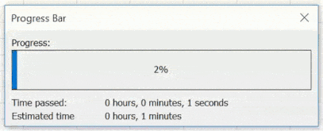
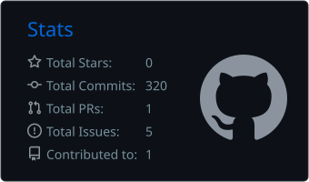
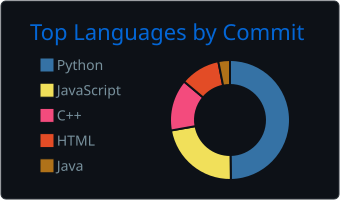
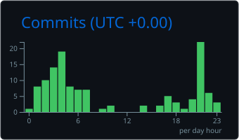

---

# Developer in process...

  

## I'm a Computer Science Engineering student from Jalisco, MX

- 📚 Studying at UDG CUALTOS
- 👾 Currently learning machine learning
- 📔 2026 goals finish my social service

 

  
### Languages:

  

  
  
 
 

### Tools:  

 

 
 
 
 
 
 
 
 

# 📊 GitHub Stats:

  
  

  
  

---

<!-- Profe si lee esto pongame 10 -->

